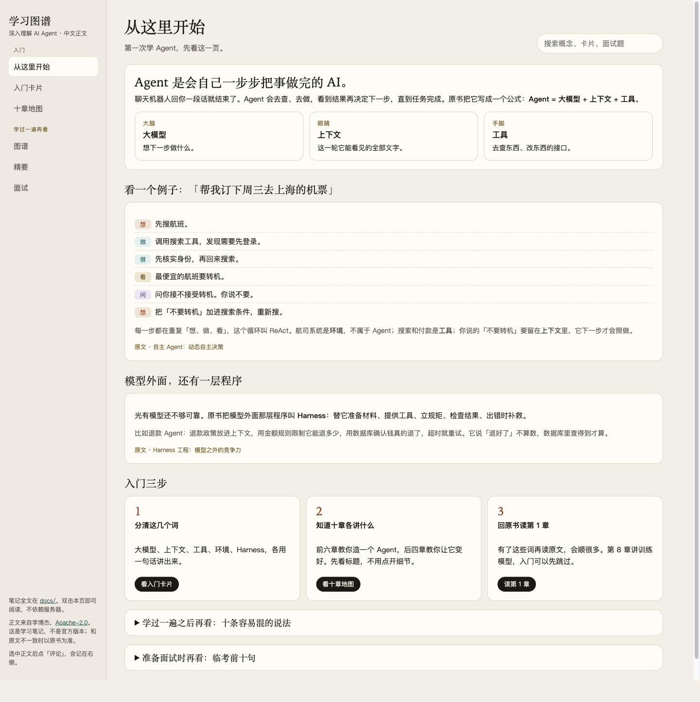
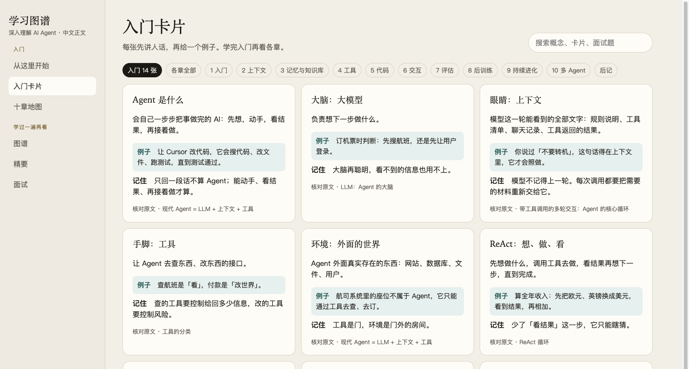
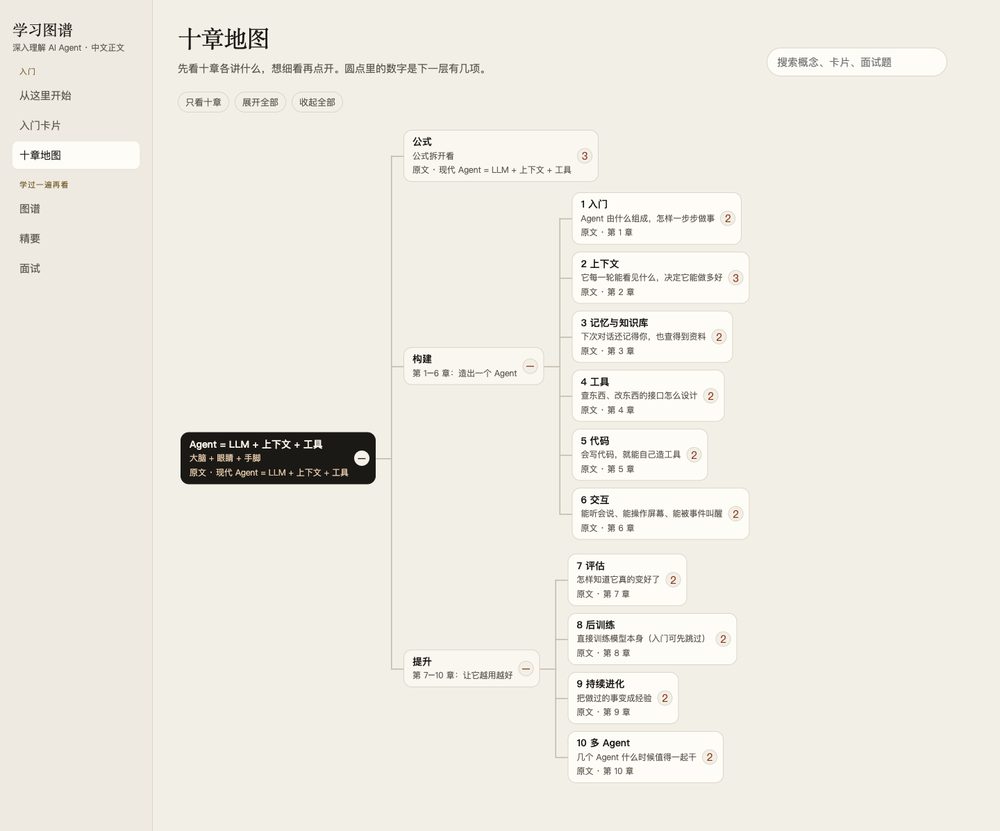
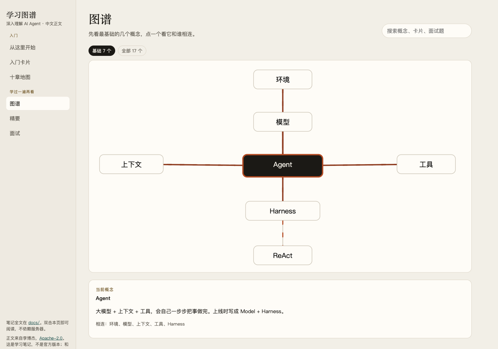

# AI Agent 学习图谱

在线阅读：<https://honestant.github.io/ai-agent-mindmap/>

把《深入理解 AI Agent：设计原理与工程实践》（[bojieli/ai-agent-book](https://github.com/bojieli/ai-agent-book)）中文正文 `book/` 整理成可复习的知识结构。其他语言译本未纳入。

这是学习笔记，不是原书替代。中文正文已复制在 [`book/`](book/)（引言、第 1–10 章、后记、思考题参考答案和配图），来自 [bojieli/ai-agent-book](https://github.com/bojieli/ai-agent-book) 的 `book/`，许可证 Apache-2.0，作者李博杰。脑图和卡片里的「原文」链到这里的对应小节。

## 怎么用

打开 [在线阅读](https://honestant.github.io/ai-agent-mindmap/)。第一次学 Agent，按左侧「入门」三页的顺序看；学过一遍再看下面三页。

| 页 | 给谁 | 内容 |
| --- | --- | --- |
| 从这里开始 | 入门 | Agent 是什么，订机票的例子，模型外面那层程序，入门三步 |
| 入门卡片 | 入门 | 14 张卡片，先讲人话，再举例子；也能切到各章的 37 张进阶卡片 |
| 十章地图 | 入门 | 默认只展开到十章，每章一句话；点开看细节 |
| 图谱 | 学过一遍 | 默认 7 个基础概念，可切到全部 17 个 |
| 精要 | 学过一遍 | 每章记住什么 |
| 面试 | 学过一遍 | 22 道可展开的问答 |

### 从这里开始

### 入门卡片

### 十章地图

### 图谱

纯文本笔记在 `docs/`：

- [核心总结](docs/核心总结.md)
- [脑图](docs/脑图.md)
- [知识图谱](docs/知识图谱.md)
- [知识卡片](docs/知识卡片.md)
- [面试重点](docs/面试重点.md)

## 全书只记这一句

**Agent = LLM + 上下文 + 工具。**

生产形态展开为 **Agent = Model + Harness**，其中 **Harness = 上下文管理 + 工具接口 + 约束 + 验证 + 纠正**。Harness 在 Agent 边界之内、模型之外，不包含环境本身。

前六章回答怎么构建，后四章回答怎么知道它变好了、怎么让它持续变好、怎么让多个 Agent 一起干活。

## 学习指南

先用这套笔记建立地图，再回原书读论证和实验。笔记负责“记住判断”，原书负责“知道为什么”。

### 第一次学 Agent

不需要先懂模型训练，也不用先看代码。

1. 打开「从这里开始」，读完订机票的例子。能说清大模型、上下文、工具各管什么，就够了。
2. 看「入门卡片」的 14 张。每张遮住「记住」那一行，自己讲一遍。
3. 看「十章地图」，只看十章的标题和那句话。前六章讲怎么造一个 Agent，后四章讲怎么让它变好。
4. 回原书读第 1 章。读不懂的词，回入门卡片里找。
5. 第 8 章讲训练模型本身，入门可以先跳过。

做到这一步，再用下面的路线往深处走。

### 按时间

| 时间 | 做什么 | 做完应能说出 |
| --- | --- | --- |
| 30 分钟 | 读「从这里开始」和入门卡片，再把十章地图看一遍 | 公式、ReAct、模型外面那层程序做什么 |
| 半天 | 读 [核心总结](docs/核心总结.md)，卡片按章扫一遍，标出看不懂的词 | 构建和提升各管什么；十条易混概念能分开 |
| 按章精读 | 每章先看脑图上的判断，再读原书该章，最后用该章卡片和面试题自测 | 这一章改变的是“看见什么”“能做什么”还是“如何变好” |
| 面试前 | 只看 [面试重点](docs/面试重点.md) 的临考十句，答不上的再翻对应卡片 | 先给判断，再给结构，最后举一个例子 |

### 按目标

- **要上手做 Agent。** 第 1–4 章按顺序走。第 1 章建立词表，第 2 章决定后面所有设计，第 3、4 章把跨会话信息和工具接口补上。第 5 章以后先跳过。
- **要做 Coding Agent。** 第 1–5 章足够做出一个能改代码、会跑测试的循环。再用第 7 章给它一个十几条任务的小评估集，用第 9 章把失败写成可回滚的知识或 Skill。
- **关心模型训练。** 先读第 1–2 章，然后第 7 章（没有评估就没有奖励），再读第 8 章。第 8 章是全书唯一需要机器学习基础的一章。
- **时间很少。** 只读第 1 章的公式、ReAct、Harness，加上第 2 章开头的三条缓存结论。KV Cache 的注意力推导可以先跳过。

### 每一章的读法

1. 在十章地图里点开这一章，先看下面的判断，不要先啃原文。
2. 读原书该章时，对照 [知识图谱](docs/知识图谱.md)：这一章是在延长上下文、扩大工具，还是在给轨迹找更新载体。
3. 读完用该章卡片的“易错”闭卷讲一遍。讲不出，就还停在名词上。
4. 从 [面试重点](docs/面试重点.md) 里挑带这一章关键词的题，先自己答，再对答案。
5. 原书实验不用逐行读。先看实验要证明哪条机制，再决定要不要动手跑。

### 建议顺序

第 1 章 → 第 2 章 → 第 4 章 → 第 3 章 → 第 5 章 → 第 7 章 → 第 9 章 → 第 6 章 → 第 10 章 → 第 8 章。

第 2 章紧挨第 1 章，因为上下文是后面的共同语言。第 4 章放在第 3 章前面，是为了先知道工具是什么，再看检索怎样变成一个工具。第 7 章放在第 9 章前面，是因为没有可比较的信号，就分不清一次修改是进步还是退化。第 8 章放最后，它改的是参数，前面的知识、Skill 和代码都解决不了时才需要它。

### 过关标准

能不看笔记回答这四句，就可以往下走：

- 模型固定时，先扩展它能看见的和能做的。
- 系统提示和工具定义定下来就不要改，变化追加到轨迹末尾。
- 验证看测试、数据库和工具返回，不看模型说“我已经做好了”。
- 一次经验要留下时，先选知识、指令、程序或参数中的一种，再用另一批不该变化的任务确认没有误伤。

## 许可证

`book/` 里的中文正文、配图和思考题参考答案来自 [bojieli/ai-agent-book](https://github.com/bojieli/ai-agent-book)，版权归李博杰（Bojie Li，Copyright 2025），许可证为 [Apache License 2.0](LICENSE)。本仓库的学习整理（页面、`docs/`、`images/`）也按 Apache-2.0 提供。原书部分子项目若另有许可证，以原仓库说明为准；这里只复制了中文 `book/`。

## 免责声明

这是学习笔记，不是原书的官方版本，也不能代替原书。脑图、图谱、卡片和总结是对原文的挑选和改写，可能省掉论证、实验条件和例外。笔记和原文不一致时，以 [原书](https://github.com/bojieli/ai-agent-book) 为准。

笔记按原样提供，不保证完整、准确，或适合某个具体项目。里面的工程判断不是法律、安全或商业建议。原作者没有参与这份整理，也不为其中的转述负责。
