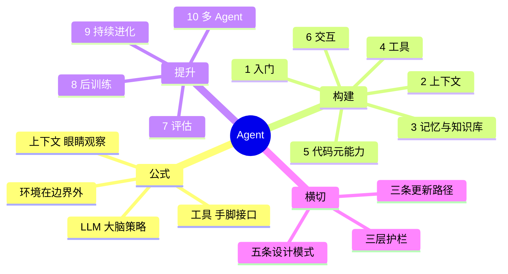

# 脑图

交互版在 [在线阅读](https://honestant.github.io/ai-agent-mindmap/) 的「脑图」页。下面是同一棵树，方便在编辑器里折叠阅读。

## Agent = LLM + 上下文 + 工具

- 直觉 / 实现 / 学术是同一结构的三种说法。[原文](../book/chapter1.md#现代-agent--llm--上下文--工具)
- 生产展开：Model + Harness（上下文、工具、约束、验证、纠正）。[原文](../book/chapter1.md#harness-工程：模型之外的竞争力)
- ReAct：想 → 做 → 看；上下文 = 静态前缀 + 轨迹。[原文](../book/chapter1.md#react-循环)
- 编排光谱：单次调用 → 工作流 → 自主 Agent → 混合。[原文](../book/chapter1.md#编排模式：工作流与自主)
- 五模式：提议者—审核者、渐进披露、只增不改、边界集+保留集、最小 diff。[原文](../book/chapter1.md#贯穿全书的设计模式)
- 护栏：上下文层、执行层、数据层。[原文](../book/chapter1.md#护栏与安全性)
- 更新：当场适应、外部产物、参数。[原文](../book/chapter1.md#agent-的学习机制：从上下文适应到持久更新)

## 构建

### 1 入门

- Demo 和产品的差距在 Harness，不在模型。[原文](../book/chapter1.md#harness-工程：模型之外的竞争力)
- 简单、透明、ACI（按 Agent 的目标设计接口，不是按底层 API）。[原文](../book/chapter1.md#构建有效-agent-的核心原则)
- 工作流路径固定、攻击面锁在节点内；自主 Agent 路径由反馈决定，必须有停止条件。[原文](../book/chapter1.md#编排模式：工作流与自主)
- 模型会吃掉适配层，但是一层一层吃。[原文](../book/afterword.md#模型与-agent-的共同演进)

### 2 上下文工程

- 上下文质量决定上限；组织不文档化，Agent 也无计可施。[原文](../book/chapter2.md#上下文：决定-agent-能力上限的关键)
- 四种角色：system / user / assistant / tool。[原文](../book/chapter2.md#消息的四种角色)
- KV Cache：前缀不变才能复用；改动越靠前，作废越多。[原文](../book/chapter2.md#kv-cache-友好的上下文设计)
- Prompt Cache 是跨请求复用那段 KV。[原文](../book/chapter2.md#kv-cache-与-prompt-cache：两个层级的缓存)
- Skills：目录常驻，正文按需，追加到轨迹末尾。[原文](../book/chapter2.md#动态提示词与-agent-skills)
- 状态栏把进度、计数、环境变化写成可检索结论。[原文](../book/chapter2.md#agent-状态栏：通过元信息增强-agent-轨迹管理)
- 压缩三个理由：装不下、不好找、模型焦虑提前收尾。[原文](../book/chapter2.md#为什么需要压缩：不只是长度问题)
- 隔离优于压缩：子 Agent 只回传结论。[原文](../book/chapter2.md#隔离优于压缩：子-agent-上下文隔离)

### 3 记忆与知识库

- 用户记忆是个人尺度，知识库是共享尺度，底层技术相通。[原文](../book/chapter3.md#用户记忆系统)
- 评估三层：基础回忆、多会话检索、主动服务。[原文](../book/chapter3.md#记忆能力的评估：三层次框架)
- 存在哪里：轨迹、长期记忆、业务状态。[原文](../book/chapter3.md#记忆的层次结构)
- 怎么存：Simple Notes、Enhanced Notes、JSON Cards、Advanced JSON Cards，再往上是可执行代码。[原文](../book/chapter3.md#用户记忆的四种存储格式)
- 存什么：情景、语义、程序。[原文](../book/chapter3.md#用户记忆的认知科学基础)
- RAG：分块 → 稠密/稀疏 → 融合 → 重排序 → 生成。[原文](../book/chapter3.md#rag-基础：构建-agent-的知识获取管道)
- 智能体化 RAG：检索是工具，Agent 自己决定搜不搜、搜什么。[原文](../book/chapter3.md#智能体化-rag：将知识检索工具化的范式转变)
- 双层：少量关键事实常驻，原始细节按需召回。[原文](../book/chapter3.md#rag-技巧：上下文感知检索)
- 检索必须按调用者权限过滤，敏感内容一旦进上下文就难保证不泄漏。[原文](../book/chapter3.md#用户记忆和知识库的定期整理)

### 4 工具

- 五类：感知、执行、协作、用户沟通、事件触发。[原文](../book/chapter4.md#工具的分类)
- 前三类本章展开；后两类放到第 6 章的异步运行时。[原文](../book/chapter4.md#工具的分类)
- 形态（专用工具 / 通用执行器 / Skill）和披露（一次看见多少）是两个独立决策。[原文](../book/chapter4.md#能力的表达形式：专用工具、通用执行器与-skill)
- 默认通用，除非安全审计、复杂参数、极高频率或平台差异。[原文](../book/chapter4.md#能力的表达形式：专用工具、通用执行器与-skill)
- 描述要写何时用、何时不用；选错工具先改描述。[原文](../book/chapter4.md#工具描述的艺术)
- 参数传递不得静默改写或静默注入。[原文](../book/chapter4.md#参数传递的保真性)
- MCP 分发专用工具，Skill Hub 分发文件夹。[原文](../book/chapter4.md#工具生态：mcp-与-skill-hub)
- 工具描述投毒、供应链、同名遮蔽。[原文](../book/chapter4.md#工具生态：mcp-与-skill-hub)

### 5 Coding 与通用 Agent

- 成熟是因为测试、类型、版本控制天然就是 Harness。[原文](../book/chapter5.md#harness-工程在-coding-agent-中的实践)
- 可靠性取决于每类故障有没有检测、恢复、接管、终止。[原文](../book/chapter5.md#故障与错误恢复)
- 代码的六个用途：思考、业务规则、多媒体、系统适配、生成式 UI、自举。[原文](../book/chapter5.md#代码：通用-agent-的元能力)
- 致命三要素 + 持久记忆放大器。[原文](../book/chapter5.md#coding-agent-的安全)
- 忠诚对象是主人；外部内容默认为数据，不是指令。[原文](../book/chapter5.md#coding-agent-的安全)
- Shell 安全靠语义解析，不靠关键字黑名单。[原文](../book/chapter5.md#coding-agent-的安全)

### 6 交互

- 两根轴：模态、时机。[原文](../book/chapter6.md#模态与触发时机的扩展)
- 异步：世界主动推事件；动作可以先发起、后收尾。[原文](../book/chapter6.md#异步与事件驱动：当世界主动找上门)
- 语音：级联 → 全模态 Omni → 全双工；快路径说话，慢路径深想。[原文](../book/chapter6.md#语音：最自然的人机接口)
- Computer Use：动作空间变成屏幕；瓶颈在效率和动作后的状态确认。[原文](../book/chapter6.md#computer-use：gui-自动化-agent)
- 机器人：动作分块用平滑换反应速度；完成与否仍由新观察判定。[原文](../book/chapter6.md#机器人操作：以-xlerobot-整理桌面为例)
- 共享原语：唤醒、安全点、取消、抢占、快慢分离。[原文](../book/chapter6.md#本章小结)

## 提升

### 7 评估

- Pass@k：k 次里至少一次成功，看能力上限。[原文](../book/chapter7.md#技术奇观：用-passk-看能力上限)
- Pass^k：连续 k 次都成功，看业务可靠性。[原文](../book/chapter7.md#业务可靠性：关注-passk)
- 环境五件：数据集、可重置状态、原子工具、评分标准、执行协议。[原文](../book/chapter7.md#五个组成要素)
- 验证器从确定规则到清单、Rubric、LLM 评判、配对比较。[原文](../book/chapter7.md#自动化评估方法)
- 三个来源：公开基准、自建业务集、生产轨迹回流。[原文](../book/chapter7.md#评估集的三个来源)
- 端到端回归看不退化；轨迹前缀边界看“拿到信息后用得对不对”。[原文](../book/chapter7.md#端到端回归任务与轨迹前缀回归任务)
- 闭环：观察 → 假设 → 实验 → 验证。[原文](../book/chapter7.md#本章小结)

### 8 后训练

- 四阶段都在改下一个 token 的概率分布，差别是“想要什么”。[原文](../book/chapter8.md#从预训练到-rl：四阶段全景)
- 预训练：海量文本，语言和世界知识。[原文](../book/chapter8.md#预训练在做什么：预测下一个词)
- Mid-training：目标分布上继续预测，补底座，防遗忘要混保留数据。[原文](../book/chapter8.md#mid-training-的本质：在目标分布上继续学习)
- SFT：只在回答上算损失，样本效率高，固化格式和流程。[原文](../book/chapter8.md#sft-的本质：换了数据的预测下一个词)
- RL：最大化期望奖励，样本贵，能强化已存在但概率低的策略。[原文](../book/chapter8.md#sft-与-rl-的本质区别)
- pass@k 接近 0 就别上 RL；格式不稳先 SFT；偶尔能做成再 RL。[原文](../book/chapter8.md#什么时候需要先补底座，再做-sftrl)
- 数据和环境比算法重要；模拟器的偏差就是训练天花板。[原文](../book/chapter8.md#本章小结)
- LoRA：SFT 用较高 rank，RL 用小 rank。[原文](../book/chapter8.md#sft-的本质：换了数据的预测下一个词)

### 9 持续进化

- 在线执行和离线学习分开。[原文](../book/chapter9.md#构建可长期运行的持续进化闭环)
- 三层信号：结果是否办成、过程是否被允许、体验是否好。[原文](../book/chapter9.md#从运行轨迹中获得学习信号)
- 低置信度不进学习集。[原文](../book/chapter9.md#从运行轨迹中获得学习信号)
- 四载体：知识文档、Prompt/Skill、程序/Harness、参数。[原文](../book/chapter9.md#agent-持续进化的四种方法)
- 发布要过边界集和保留集，能灰度、能回滚。[原文](../book/chapter9.md#可验证闭环的边界：当完成不等于进步)
- 结果可自动验证的任务上，这条闭环最可靠。[原文](../book/chapter9.md#本章小结)

### 10 多 Agent

- 唯一判据：协作有没有带来单次生成拿不到的新信息。[原文](../book/chapter10.md#多-agent-何时真正优于单-agent)
- 自己审自己、对着同一段文本辩论，通常不增加信息。[原文](../book/chapter10.md#多-agent-何时真正优于单-agent)
- 测试结果、截图、外部核验，会增加信息。[原文](../book/chapter10.md#多-agent-何时真正优于单-agent)
- 维度一：上下文共享还是隔离。[原文](../book/chapter10.md#维度一：上下文是否共享)
- 维度二：对等、管理者、去中心化。[原文](../book/chapter10.md#维度二：协作拓扑)
- 通信：工具参数、共享文件、消息总线。[原文](../book/chapter10.md#维度一：上下文是否共享)
- 失败：并发冲突、级联、同质趋同、扯皮、循环失控、理解债。[原文](../book/chapter10.md#多-agent-协作的失败模式)
- 跨组织互操作看 A2A；人不能把理解一起外包出去。[原文](../book/chapter10.md#失败模式六：理解债与认知投降)
